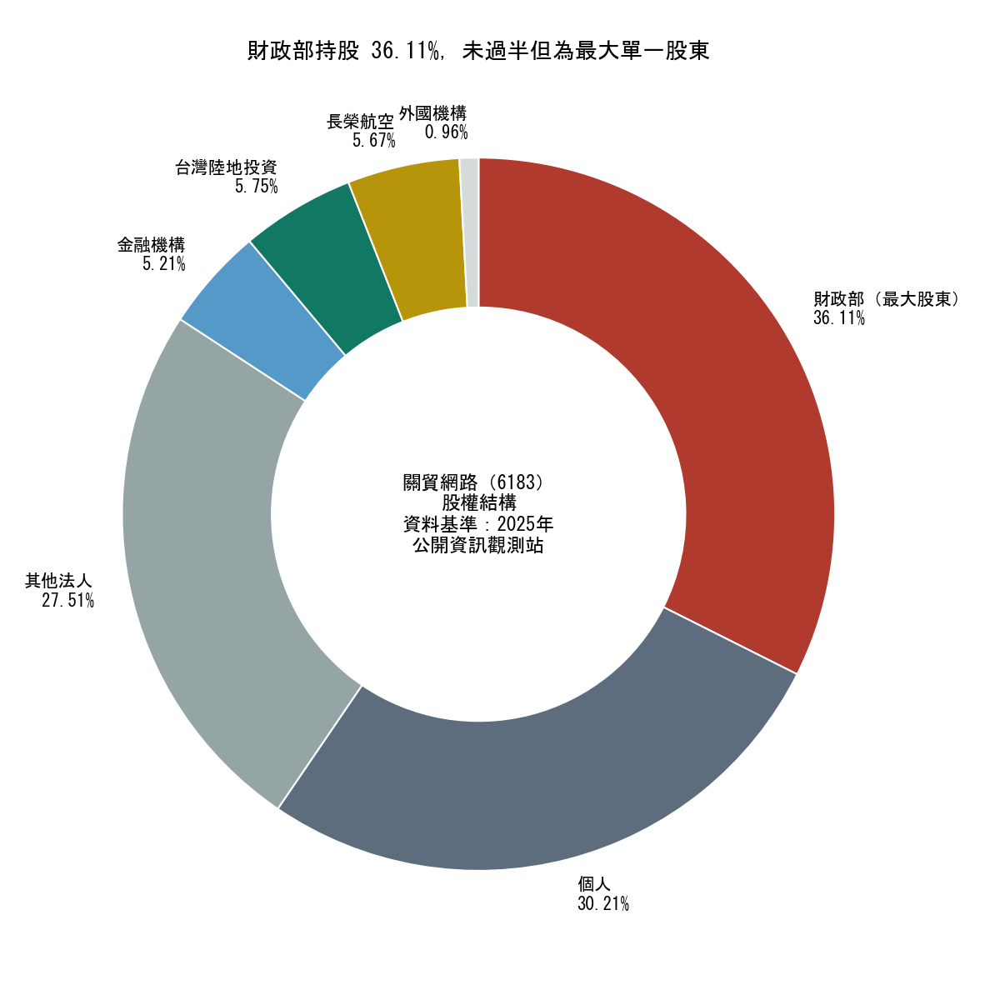
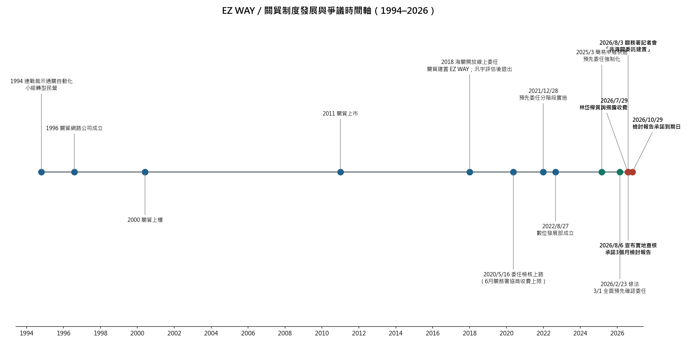
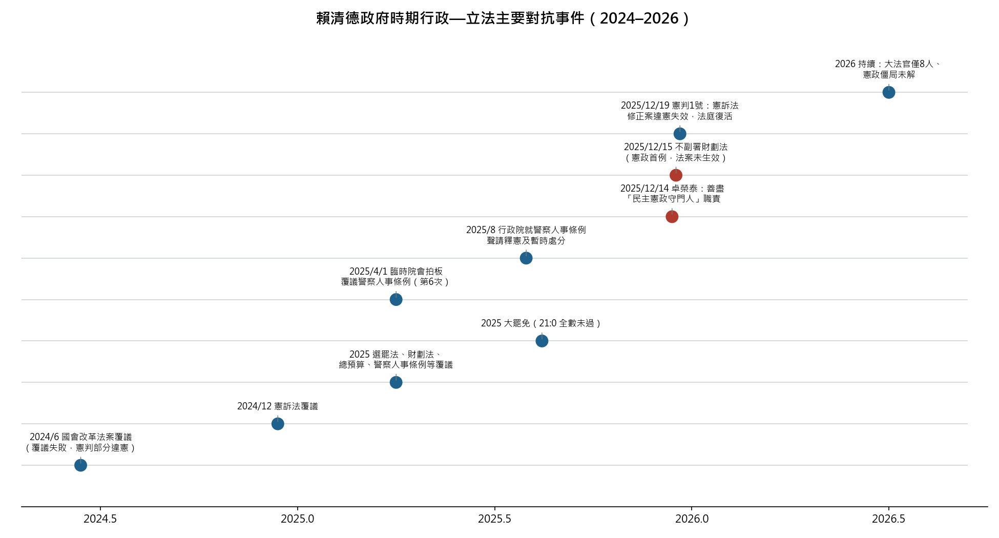

# EZ WAY 易利委與關貿網路爭議：完整事實研究報告

**研究基準日：2026 年 10 月 8 日**
**資料基礎：舊研究報告三份（2026-09-22 語料庫）、八輪公開網路查證、關務署書面說明稿、全國法規資料庫、立法院公報**

---

## TL;DR

EZ WAY 易利委不是政府機關開發的 App，也不是關貿網路的子公司產品——它是**關貿網路（6183）本體自行投資建置的服務**。關貿的前身是財政部任務編組，目前**財政部持股 36.11% 為最大單一股東，並在 12 席一般董事中取得 6 席、指派董事長與總經理**，台灣事實查核中心已將「EZ WAY 是私人企業」的網傳說法判為錯誤。法規層面（《空運快遞貨物通關辦法》第 17 條）確實保留紙本委任、單一窗口線上委任、實名認證平台三條路，EZ WAY 只是其中一款；但關務署 2026 年 8 月 3 日自己的書面說明承認「實務上跨境電商平台雖多預設民眾已註冊 EZ Way APP，並要求民眾須先確認委任才發貨」——**卡住消費者的不是法條，是制度與平台流程共同造成的實質必要**。2018 年開放線上委任時主管機關僅邀請關貿與汎宇評估，汎宇因營運考量退出，市場自此單一化；政府從未督導建立第二個同等整合度的替代方案。關務署署長 2026 年 7 月 29 日承諾 3 個月內提出檢討報告（約 10 月 29 日到期），財政部 8 月 6 日宣布實地查核時另承諾 3 個月檢討報告（約 11 月 6 日到期）；截至本報告基準日**兩份報告均尚未公布，實地查核結果亦未公開，監察院與公平會均未見立案調查的公開紀錄**（2026-10-09 增量複查確認無新進展）。本報告同時整理賴清德政府時期行政—立法對抗事件（6 次覆議、2025/12/15 不副署財劃法創憲政首例），指出「以憲政守門人職責對抗國會」已成為可被公開發言佐證的持續性模式。

---

## 一、研究背景、舊資料位置與查證方法

本報告係應要求重新執行先前研究的第 1、2、4、5 項題目，並結合舊資料、最新網路資料與法源，對 EZ WAY 爭議做出全面、客觀的事實彙整。先前研究的三份舊報告已從本機歷史任務目錄中尋獲並重新核對，其位置與內容如下：第一份《EZWAY台灣外包》完成於本機語料庫 `2026-09-22` 任務目錄，內容涵蓋法源依據、委任與授權之辨、其他通關網路業者、圖利疑慮之法律分析、收費之法律性質五大區塊；第二份《EZWAY台灣外包2》為股權數字查證，確認財政部持股 36.11%、54,162,436 股、12 席一般董事中 6 席為財政部法人代表、按每股 3.55 元股利計算財政部約獲配 1.92 億元，並查證羅廷瑋委員 2026 年 8 月 4 日「政策／私人交易／無委託契約／最大股東」的公開發言確有報導與質詢紀錄；第三份為台灣中央政府公營及政府控制事業盤點，發現政府控制事業清冊 CSV 中出現 Trade-Van 境外公司，屬關鍵線索但未能建立完整母子孫公司持股鏈。

查證方法上，本報告以關務署與財政部**書面說明稿**為最高優先的一手來源，其次為全國法規資料庫條文、公開資訊觀測站與關貿官網資料，再次為中央社等通訊社與主要媒體，最後才是部落格、社群與論壇的實務經驗陳述。需要特別說明的是一個方法論上的重要發現：2026 年 8 月初媒體所稱「關務署澄清 3 大誤解」，在三份書面稿的標題與內文中其實都未出現該詞，那是記者會的媒體歸納；而「每件 0.8～3.5 元」的費率級距也同樣未出現在任何關務署書面稿中，僅見於記者會轉述。凡此落差，本報告一律以書面稿口徑為準，並在文中標註兩者差異。截至 2026 年 10 月 8 日，8 月 6 日宣布的實地查核結果、「114 年通關網路營運報告書」的個資保護說明、以及承諾 3 個月內提出的檢討報告，三者均未見公布。

---

## 二、EZ WAY 的身分、股權與利益

### 2.1 EZ WAY 是誰的產品：不是政府 App，也不是子公司

EZ WAY 易利委在 App Store 的開發者欄位為「Trade-Van Information Services Co.」，即關貿網路股份有限公司本體，App 自述為「關貿網路通關加值服務-報關委任」。因此嚴格回答「EZ WAY 是否是政府或關貿的子公司、孫公司」這個問題：**EZ WAY 不是任何公司的子公司，它是關貿網路（6183）本體自行投資建置、自行營運的服務**，沒有獨立的子公司法人承載其業務。這一點在法律上有實質意義：消費者要客訴，打的是關貿客服（02-7735-2812），不是海關；要行使個資法上的刪除請求，找的是關貿的個資服務專員（02-26551188）。政府與 EZ WAY 之間沒有委託契約、沒有合作協定，關務署署長彭英偉 2026 年 8 月 3 日在記者會上明確表示 EZ WAY 係關貿「因應 107 年海關法規鬆綁，自行投資建置營運之線上委任 APP」[^16^][^18^]。

關貿自身的身世則解釋了為何它「不像一般民營公司」。其前身為「財政部貨物通關自動化規劃推行小組」，1994 年 10 月 21 日由時任行政院長連戰裁示轉型民營、政府持股須降至 49% 以下，1996 年 8 月正式成立公司，2000 年上櫃、2011 年上市，是台灣首例由政府臨時任務編組直接移轉民營的公司[^10^][^13^]。這個歷史定位意味著：EZ WAY 從來不是「純私人企業」的產品，也不是「政府機關」的產品，而是一個**由財政部任務編組轉型而來、政府持最大股、上市民營公司所建置的通關加值服務**。這個「中間形態」正是整個爭議難以用一句話定性的根源。

### 2.2 股權、董事會與股利：最大股東加過半一般董事席次

股權結構的核心數字已從多個一手來源確認：財政部持有 **54,162,436 股、36.11%**，為最大單一股東；其餘主要股東為台灣陸地投資 5.75%（8,621,705 股）、長榮航空 5.67%（8,502,418 股）、兆豐銀行約 4.48%；另有個人 30.21%、其他法人 27.51%、金融機構 5.21%、外資 0.96%[^1^][^2^][^3^]。依 2025 年公開資訊觀測站資料的法說會簡報，政府機構合計即為 36.11%，且全部集中於財政部[^1^]。

| 項目 | 數字 | 來源性質 | 查證狀態 |
|---|---|---|---|
| 財政部持股 | 54,162,436 股、36.11% | 關貿官網股東專欄、券商董監資料庫、2025 法說會簡報 | ✅ 多源一致 |
| 一般董事 12 席中財政部法人代表 | 6 席（張陸生、許寧佑、戴龍輝、查士朝、倪麗心，並由高國峰兼任總經理） | 2026/6/26 董事改選公告 | ✅ 已確認 |
| 獨立董事 | 3 席（郭雨新、游琦俊、孫嘉明） | 同上 | ✅ 已確認 |
| 2026 年現金股利 | 每股 3.55 元，財政部約獲配 1.92 億元 | 股東會決議、媒體計算 | ✅ 計算正確 |
| 2026 上半年獲利 | 營收 13.59 億、淨利 3.62 億、EPS 2.41 元 | 2026/8/11 法說會 | ✅ 已確認 |
| 「EZ WAY 是私人企業」網傳 | 事實查核中心報告 4263 判為「錯誤」 | 台灣事實查核中心 | ✅ 已確認 |

這裡的關鍵不在於 36.11% 是否過半——它離過半還差 13.89 個百分點——而在於「**最大單一股東＋12 席一般董事恰好取得 6 席＋指派董事長與總經理**」的組合，使財政部在一般董事會上具有穩定過半的治理影響力[^5^][^8^][^13^]。台灣事實查核中心報告 4263 的基準資料（關貿官網 115 年 4 月 28 日主要股東名單）明確記載財政部「指派董事長與總經理」[^13^]。至於 2026 年股利，每股現金股利 3.55 元乘以 54,162,436 股等於 192,276,648 元，媒體報導的「約 1 億 9,228 萬元」計算相符[^6^][^7^]。但必須精確指出：這筆股利是財政部持有關貿股份所得的**公司整體盈餘分配**，不能直接說成「EZ WAY 收入分給財政部」——關貿未公開揭露 EZ WAY 的獨立收入、成本與毛利，這個連結所需的資料目前不存在於公開領域。

### 2.3 利益獲得者是誰：一個分層的答案

若問「誰是 EZ WAY 的利益獲得者」，公開資料支持的分層答案如下。第一層是**關貿網路本身**：EZ WAY 的確認費與串接服務費由關貿向報關及承攬業者收取，立委林岱樺 2026 年 7 月 29 日質詢揭露的費率為每筆最高 3.5 元確認費，若採源頭 SFTP 資訊串接另需月費 2,500 元加每筆 0.8 元服務費[^19^][^20^]；媒體轉述的級距說法為每筆約 0.8～3.5 元[^16^]。第二層是**全體股東**：關貿 2026 年上半年營收 13.59 億元、淨利 3.62 億元，EPS 2.41 元，皆為雙位數成長，其中財政部以 36.11% 持股比例取得最大單一股東份額的股利[^4^][^6^]。第三層是**報關業者的成本結構**：費用名義上向報關業者收取，報關業者是否轉嫁消費者屬商業行為，關務署公開說法僅承認「委員質詢」「立法委員建議」，書面稿從未確認或否認轉嫁，目前也查無可驗證的運費拆項證據[^13^]。

至於「政府是否透過政策把利益輸送給其持股或具影響力的公司」，現有證據支持的精確結論是：**有結構性的利益衝突與市場集中事實，但沒有達到刑事圖利要件的直接證據**。掌握全台約 75% 進口報單的關貿，其 EZ WAY 在 2018 年線上委任開放時由主管機關邀請評估的對象只有兩家——關貿與汎宇——汎宇因自身營運考量退出後，關貿以「救火團隊」姿態填補政策空窗，如今市場上缺乏其他同類 App[^14^][^15^]。知情官員對媒體的這段描述本身即承認：線上委任市場的形成不是自由競爭的結果，而是「主管機關邀請評估→一家退出→一家承接」的政策引導過程。是否構成《貪污治罪條例》的圖利，仍須證明公務員明知違背法令、利用職務使特定私人取得不法利益及主觀犯意，現有公開資料尚未達到此門檻；但「政府既是監管者、又是收費服務提供者的最大股東」這個外觀，已由羅廷瑋委員的質詢命題精準命中，且四個層面（股權、董事會、股利、責任分配）都具備可驗證的事實基礎[^9^]。

---

## 三、政府政策與公共責任

### 3.1 時間表對齊：數發部成立比 EZ WAY 晚了四年

要求對齊的「數發部成立與 EZ WAY 建置時間表」如下：1994 年連戰裁示轉型、1996 年關貿公司成立、**2018 年海關開放線上委任、關貿自行建置 EZ WAY**（汎宇評估後退出）、**2020 年 5 月 16 日委任檢核上路**，2020 年 6 月 17 日關務署召開「實名認證線上委任報關服務收費說明會」協商收費上限並調降費率、2021 年 12 月 28 日起預先委任分階段實施、2021 年 9 月 15 日起為「預先委任 2.0」、**2022 年 8 月 27 日數位發展部才掛牌成立**（首任部長唐鳳）、2025 年 3 月簡易申報快遞預先委任強制化、2026 年 2 月 23 日財政部修正發布空運與海運快遞貨物通關辦法，**3 月 1 日起全面實施預先確認委任**[^13^][^24^][^25^][^31^][^38^]。

這個時間軸的意義在於：**EZ WAY 的建置與市場獨占地位的奠定（2018–2021），完全發生在數發部成立之前**。數發部 2022 年成立時，EZ WAY 已運作近四年、預先委任制度已全面推開，數發部從未參與線上委任制度的起草或監管分工；關貿的個資目的事業主管機關目前仍是數發部，個人資料保護委員會則尚在籌備（2026-10-02 複查 pdpc.gov.tw 仍僅見籌備處公告，正式掛牌已自 2023 年底延宕近三年）[^13^]。因此若問「政府不自行開發數位治理工具、由民間提供、政府持股的模式是什麼政策」，答案是：**這不是一項有明文名稱的政策，而是 1990 年代「政府任務編組公司化」路徑在 2018 年法規鬆綁時的慣性延伸**——通關自動化的基礎建設由轉型的官股民營公司承接，線上委任這個新缺口也自然由同一家公司填補，過程中沒有任何一個機關負責回答「為什麼是這家公司、有沒有第二家」。

### 3.2 「不是委託建置」「私人交易」能否切割公共責任

關務署 2026 年 8 月的三份書面稿建立了三層切割論述：EZ WAY 非海關委託建置（無契約）、收費是關貿與報關業者間的私契約行為（非規費）、法規保留紙本與單一窗口等替代途徑（非強制）[^16^][^18^][^22^]。這三層在形式上各自成立，但切割公共責任的效力值得逐項檢驗。第一層「無委託契約」成立，但無法回答為何 2018 年開放線上委任時**主管機關主動邀請評估的對象只有關貿與汎宇兩家**——這本身就是一種政策作為，只是沒有留下委託契約的形式[^14^]。第二層「私人交易」成立於法律形式，但 2020 年 6 月 17 日關務署親自召集業者公協會與關貿協商收費上限並調降費率的紀錄顯示，**收費從未真正脫離主管機關的介入**；國發會一份「松綁招商」文件更白紙黑字記載「其收費由業者自行協調訂定，毋須申請財政部同意。惟關務署為通關網路業務主管機關，負有監管之責」[^25^]。第三層「法規保留替代途徑」則被關務署自己 8 月 3 日補充說明的後半句削弱：「實務上跨境電商平台雖多預設民眾已註冊 EZ Way APP，並要求民眾須先確認委任才發貨」——官方親口承認制度運作的實態與法條文字之間存在落差[^13^][^18^]。

「政府具有股權與經營影響力，是否接受民意機關監督」的問題，實務答案是**選擇性的**。關貿作為上市公司受《證券交易法》與公司治理規範約束，財政部作為股東受《預算法》與國有股權管理規範約束，這些都是真的；但 2026 年 7 月 29 日林岱樺在立法院財政委員會質詢揭露收費結構之前，**EZ WAY 的費率、收費對象、SFTP 串接月費從未出現在關務署任何公開文件中**，立法院與民眾是在質詢桌上才第一次看見這些數字[^19^][^20^]。截至本報告基準日，關務署是否充分履行立法院監督及法定監管要求，可由三個未完成的承諾衡量：8 月 6 日宣布的實地查核結果未公布、函請關貿在「114 年通關網路營運報告書」說明個資保護的措施未公開、3 個月檢討報告未提出（注意有兩個期限：署長 7/29 質詢承諾約 10 月 29 日到期，財政部 8/6 宣布的另一份承諾約 11 月 6 日到期）[^21^][^22^][^23^]。政府為何沒有督導建立一個以上真正可選的替代方案，公開紀錄中找不到任何答案——2018 年之後沒有任何一次公開徵求、招標或補助，鼓勵第二家業者建置線上委任 App。

---

## 四、法律規定與平台實際要求的落差

### 4.1 法條寫什麼：《空運快遞貨物通關辦法》第 17 條的三條路

現行法制對快遞報關委任的規定可以精確到條項。《關稅法》第 16 條要求進口貨物申報、第 22 條允許委託報關業者辦理；在此之上，《空運快遞貨物通關辦法》第 17 條第 1 項明列三款委任方式：❶ 以書面辦理個案或長期委任；❷ 經由關港貿單一窗口辦理線上個案或長期委任；❸ 經由經營通關網路業者建置之實名認證平台辦理線上個案委任——EZ WAY 即屬第三款。海運快遞貨物通關辦法第 18 條有相同結構。第 17 條第 2 項則規定未完成委任並於海關系統記錄有案者，**海關得不受理報關**。條文沒有寫「必須使用 EZ WAY」，這一點政府說法正確[^13^][^24^]。

但條文裡藏著兩個媒體幾乎沒報導過的細節。第一，第三款（EZ WAY 這條）**只有「個案」沒有「長期」**——消費者每一票包裹收到的推播，法律上都是一次獨立的委任，這就是推播「永遠按不完」的法源原因；想一次授權管五年，法條上只有第二款（單一窗口）做得到[^13^]。第二，預先委任的強制化是分階段推進的：2020/5/16 起委任檢核（未委任且未實名認證者不受理報關）、2021/12/28 起分階段預先委任、2025/3 起簡易申報快遞強制化、2026/3/1 起全面實施預先確認委任，未完成者收單時回傳 **B6F 錯單不予收單**——這是財政部以命令修正發布的法規義務，不是關貿的商業要求[^13^][^24^][^31^]。截至 2025 年 11 月 30 日，逾 300 萬民眾加入預先委任、**報單採用預先委任比率逾 8 成**；註冊用戶數則逾 759 萬人[^10^][^13^]。

### 4.2 平台流程中的實際強制：官方自己承認的落差

「法律沒有指定 EZ WAY，但淘寶等平台要求完成 EZ WAY 才能出貨，這是不是事實？」——是，而且這個事實最權威的出處不是投訴文，而是關務署自己的書面稿。2026 年 8 月 3 日〈海關對民眾使用 EZ Way APP 所生疑慮補充說明〉原文：「現行法規明定線上委任與紙本委任得擇一採行，**實務上跨境電商平台雖多預設民眾已註冊 EZ Way APP，並要求民眾須先確認委任才發貨**，惟民眾倘未註冊 EZ Way APP 或人在境外無法確認委任狀態，仍可要求報關業者使用紙本委任報關」[^13^][^18^]。前半句是政府對外說的，後半句是同一張紙上、卻很少被轉述的部分——這半句等於關務署親口承認：**在法規層與平台層之間，存在一個由平台流程構成的實質強制，而海關對此既知情、也默許**。

實務面的證據鏈與官方說法完全吻合。集運教學文普遍記載「不按申報相符＝海關不受理報關＝整櫃無法清櫃」，Buy&Ship 自 2024 年起將 EZ WAY 預授權列為轉運的必要步驟，「包稅」與「不包稅」的集運都一樣要求本人按確認——因為 EZ WAY 綁定的是身分證字號與手機門號，**這一步無法由業者代點**[^26^][^27^][^28^]。Mobile01 的集運討論串中，消費者被要求確認與實際購買內容不符的申報內容，「不確認就不幫忙送」，呈現制度強制與申報不實風險由消費者承擔的兩難[^33^]。所以「法律沒有強制」不能否定平台流程中的實際強制——兩者分屬不同層次，政府說法只回答了前者，而關務署書面稿證明後者為真。

法規所稱「其他委任途徑」具體是三個：紙本個案委任、紙本長期委任（受固定進出口人長期委任者得先檢具委任書由海關登錄，之後報單填登錄字號即可，見《報關業設置管理辦法》第 12 條）、以及關港貿單一窗口線上委任（免費、一次授權效期可達 5 年，但需自然人或工商憑證加讀卡機，且**綁定特定受任人**，換報關業者即失效）[^13^]。這三個途徑在法律上都存在，在跨境網購的原交易流程中卻都有斷點：紙本需要報關業者願意配合且消費者能聯繫到對方；單一窗口需要電腦、讀卡機、憑證環境，且官方對「個人能否以自己名義辦成」的說法前後不一；沒有任何證據顯示淘寶、蝦皮、亞馬遜或任何一家主流集運商的既定物流流程中，消費者可以直接選用這些替代方式[^13^][^30^]。這正是「法律形式允許」與「交易實務可選」之間的核心落差：以「沒有明文禁止」推論「人民有選擇」，是以法律術語掩蓋交易流程中的事實。

---

## 五、替代平台與電子報關

### 5.1 為什麼沒有第二家 EZ WAY

公開紀錄給出的答案是「市場太小，沒人要做」，但這個答案经不起追問。2018 年線上委任開放時，主管機關邀請具通關網路資格的關貿與汎宇評估投入，**汎宇因自身營運考量退出，關貿決定接手**；知情官員對媒體形容當時線上委任「使用規模及商業模式都不健全」，關貿宛如救火團隊[^14^][^15^]。2026 年 8 月關務署的說法維持同一路線：具通關網路經營資格者不只一家，「汎宇目前沒有投入開發線上委任 APP 的意願」，通關業務科科長陳怡蒨並指出「目前符合相關條件的 2 家業者中，僅關貿公司有意願提供線上委任服務」[^10^][^17^][^36^]。問題在於：為什麼 8 年過去，市場從「不健全」成長到 759 萬註冊用戶、八成報單採用，卻依然沒有第二家業者認為值得投入？合理的懷疑方向是：EZ WAY 的先發優勢已與海關系統、報關業者流程、平台預設深度綁定，第二家業者面對的不是一個開放市場，而是一個**由制度鎖定的既有標準**——但這個懷疑目前缺乏公開文件可以直接證明（例如其他業者是否曾申請相同 API、資料格式與測試環境而遭拒），屬於「形式開放、實質排他」的待查區塊。

### 5.2 台灣还有哪些系統可以做電子報關：功能整合度對照

台灣的電子報關體系由多個層次構成，把它們與 EZ WAY 放在同一張表比較，答案就清楚了：其他系統存在，但沒有任何一個具有與 EZ WAY 相同的功能與整合程度。

| 系統／平台 | 營運者 | 功能範圍 | 個人跨境網購可用 | 與 EZ WAY 的整合度比較 |
|---|---|---|---|---|
| EZ WAY 易利委 | 關貿網路（財政部持股 36.11%） | 實名認證、逐票推播確認、預先委任、繳稅通知 | ✅ 為其事實標準 | 基準本身 |
| 關港貿單一窗口線上委任 | 財政部（免費） | 線上個案／長期委任，效期可達 5 年 | ⚠️ 需自然人／工商憑證＋讀卡機，綁定特定受任人，換報關行即失效 | 只有委任功能，無推播、無報關行普遍介接 |
| 紙本委任 | 進口人＋報關業者 | 個案或長期（海關登錄字號） | ⚠️ 需報關業者配合；集運流程中難以使用 | 功能完整但完全在數位流程之外 |
| 汎宇電商通關網路 | 汎宇電商（純民營） | 企業通關網路連線（空運報關 180 家、海運 250 家客戶） | ❌ 無面向個人消費者的線上委任 App | 企業端基礎設施，不觸及消費者委任環節 |
| 報關行自有系統 | 各報關業者 | 申報作業 | ❌ 委任確認仍須回到 EZ WAY 或紙本 | 依附於委任機制，非替代品 |

資料來源：汎宇官網之通關網路服務說明[^35^]、關務署與基隆關對單一窗口線上委任的說明[^13^]、關務署對兩家具資格業者現況之說明[^17^][^36^]。

因此，對「『其他電子關務系統存在』是否足以回答『消費者有同等替代平台』」這個問題，事實答案是**否定的**：單一窗口是「只有部分功能」的公家替代（免費但門檻與綁定條件使它不適用於流動的集運場景）；汎宇是「只有企業端功能」的現存執照業者；紙本是合法的但位於整個數位交易流程之外。至於「為何其他報關行不採用替代平台」——從報關行的角度這個問題其實反過來：報關行不是不採用替代方案，而是**委任確認這一環根本沒有第二個數位選項可用**，8 年來唯一對接海關預先委任邏輯的消費者端工具就是 EZ WAY。

---

## 六、行政院、立法院與政治運作

### 6.1 「阻止立法院法案實施是其職責」：從不副署財劃法到「憲政守門人」

要求查證的「行政院長宣稱阻止立法院法案實施是其職責」事件，核心是 2025 年 12 月的財劃法僵局。立法院 2025 年 11 月 14 日三讀修正《財政收支劃分法》，行政院提出覆議遭藍白否決；12 月 14 日深夜，行政院長卓榮泰公開發聲表示將善盡「**民主憲政守門人**」職責[^41^]；12 月 15 日下午，他召開「捍衛憲政秩序」記者會，依《憲法》第 37 條宣布**不予副署**，使法案無法生效——這是憲政史上首次有行政院長不副署「法案」（過去僅郝柏村不副署人事案）[^39^][^40^][^42^]。卓榮泰自述「為了堅守三大民主憲政責任，必須以不副署方式捍衛民主憲政」，並直指立法院「既能制定預算，又能審定預算，就像球員兼裁判」[^43^][^44^]。

這個事件的查證結論需要精確表述：卓榮泰的原話框架是「善盡民主憲政守門人職責」「行政院有責任捍衛權力分立原則」，而不是字面意義的「阻止立法院法案實施是我的職責」；但其行為效果與這個字面說法等價——**以憲政機制中最後一道程序性權力，使國會多數決通過的法案不生效**。值得並置對照的是，財劃法「球員兼裁判」的批評語言，與本案中被質疑的關貿「政府既是監管者又是股東」結構，形成了同一時期政府論述與政府實踐之間的鏡像張力。

### 6.2 賴清德上任後行政—立法對抗的主要事件

賴清德 2024 年 5 月 20 日就任後，行政院與立法院的對抗可按時間排列為一個清晰的事件序列。2024 年 6 月，行政院甫改組即對國會改革相關法案提出覆議（覆議失敗，憲法法庭其後宣告部分違憲）；2024 年 12 月對憲訴法修正案提出覆議；2025 年間對選罷法、財劃法、114 年度總預算案、警察人員人事條例等陸續提出覆議，2025 年 4 月 1 日行政院召開臨時院會拍板覆議警察人事條例，使卓榮泰上任不滿一年即累計 6 次覆議，國民黨團總召傅崐萁稱其為「國內外史上提出最多覆議案的行政院長」[^45^]。同一時期，立法院民眾黨團三度對卓榮泰提出譴責案，指控其「拒絕依法行政、以行政權力對抗國會監督」；卓榮泰在質詢台上則回應「我們覆議是被動的，釋憲是被動的，窒礙難行也是被動的，主動方都在委員身上」[^46^]。

對抗在 2025 年下半年進入憲政機構層面：2024 年底藍白修改《憲法訴訟法》提高裁判門檻，加上大法官人事案兩度遭否決，憲法法庭實質停擺逾一年；2025 年 12 月 19 日憲法法庭作成「114 年憲判字第 1 號」判決，宣告憲訴法修正案違憲失效，法庭始得復活，惟至 2026 年 2 月仍僅 8 位大法官、低於新制 10 人評議門檻的結構性問題未解[^47^][^48^]。2025 年 8 月行政院就警察人事條例聲請釋憲及暫時處分，內政部以「等待釋憲結果」為由遲未執行已生效法律的撥付，2026 年 2 月逾 2,000 名退休警消提起史上最大規模退休公務人員團體訴訟——形成「**法律已生效、預算未到位、釋憲未排審**」的三重僵局[^49^]。加上 2025 年的大罷免（對在野黨立委的罷免案全數未過），這個事件序列已無法被描述為「單一案件」。

### 6.3 「單一案件」還是「持續模式」：證據的判斷

就「多項事件與公開發言出現後，是否還能稱為單一案件」這個問題，事實層面的答案是：**不能**。從 2024 年 6 月到 2026 年，對抗橫跨覆議、釋憲、暫時處分、不副署、人事杯葛、罷免動員六種憲政工具，對象橫跨國會改革、憲訴、選罷、財劃、預算、警消、軍人待遇、禁伐補償八個法案領域，且行政院長的公開發言（「民主憲政守門人職責」「不接受立法院隨意擴張權力」「停止惡法傷害國家」）已為行動目的提供了第一手的陳述證據[^41^][^43^][^44^]。「反覆行為是否支持持續、系統性的行政—立法對抗模式」——以事件密度、工具多樣性、公開論述的一致性三項指標衡量，支持該描述的證據強度高於反對證據。當然，對抗模式的存在不等於對抗沒有憲法依據：覆議權與副署權都是憲文明定機制，爭點在於其使用密度與目的陳述是否已改變憲政慣例的性質，這是價值判斷層次的問題，超出本報告的事實範圍。

至於「官員具律師背景不能代替證據」的質疑，其對應的具體情境是：面對「覆議或不副署的決策過程為何」這類決策事實問題，官方多以憲法論述與法律人資格回應（如卓榮泰在記者會上完整引用就職誓詞與憲法第 53 條），而**未曾公開決策會議紀錄、法律意見書或不同方案的評估紀錄**；律師背景可以支撐論述的正當性，確實不能替代對具體決策過程的證明[^43^]。你以陳述方式提出的兩項政治質疑——「民進黨在野時鬥爭執政黨、執政時鬥爭立法院」以及「對立、分化與鬥爭是否已成為政府運作模式」——本報告不為其背書或否定，但指出：第一項作為歷史描述涉及 2008–2016 與 2024 以降兩個時期的可比性問題，需要另案以事件資料檢驗；第二項作為現狀描述，與本章所列事件的公開紀錄相容，但其最終判斷取決於對「鬥爭」與「制衡」的定義界線，屬於政治評價而非事實查證。

---

## 七、綜合分析：核心命題的逐項檢驗

你反覆追問的核心是：不能只證明「法律允許其他方法」就宣稱「人民實際有其他選擇」；也不能只說「尚未證明違法」就代替對政策利益、公共責任與監督成效的回答。將本案全部已查證事實對照這個核心，可以得到七個層次的檢驗結果，每一層都有明確的證據狀態。

| 層次 | 主張 | 證據狀態 | 關鍵依據 |
|---|---|---|---|
| 1 | 法律沒有指定 EZ WAY | ✅ 成立 | 通關辦法第 17 條明列三款 |
| 2 | 平台流程實質要求 EZ WAY 才能出貨 | ✅ 成立 | 關務署 8/3 書面稿自承「平台要求先確認委任才發貨」 |
| 3 | 替代途徑在跨境網購原流程中可直接使用 | ❌ 不成立 | 三途徑均有斷點，無平台介接證據 |
| 4 | 政府是收費服務提供者的最大股東兼過半一般董事 | ✅ 成立 | 36.11%＋6/12 董事＋指派董事長總經理 |
| 5 | 收費與股利使政府直接獲得 EZ WAY 收入 | ⚠️ 部分成立 | 股利為整體盈餘分配；EZ WAY 獨立財務未公開 |
| 6 | 政府盡了建立多元替代方案的督導責任 | ❌ 不成立 | 2018 年後無任何公開徵求或扶植第二家的紀錄 |
| 7 | 已達刑事圖利或違法程度 | ⚠️ 未能證明 | 無違法決策與主觀犯意證據；但圖利疑雲的結構性要件齊備 |

這個表格揭示了爭議的真正結構：政府說法集中在層次 1 與層次 5 的保守解讀，而人民的實際處境集中在層次 2、3、6。**層次 1 的真不能抵消層次 2 的真，層次 7 的未證明也不能抵消層次 4 與層次 6 的已證明**。這正是為什麼「尚未證明違法」無法成為對本爭議的完整回答——因為被質疑的對象從來不只是「是否違法」，而是「政策設計是否恰當、公共責任是否被切割、監督是否到位」，這三個問題的答案都不以刑事違法為前提。

### 7.1 「形式合法—實質單一」的制度機制

把 2018 年的事件與 2026 年的狀態連起來看，可以辨識出一個清晰的制度機制：法規鬆綁（2018）→ 主管機關僅邀請兩家評估、一家退出（2018）→ 系統檢核使委任電子化成為報關前提（2020）→ 收費由主管機關協商上限但未設定長期費率規範（2020）→ 預先委任分階段強制化（2021–2026/3）→ 八成報單採用、759 萬註冊用戶（2026）→ 收費結構在質詢桌上才首次公開（2026/7）→ 「非委託建置、市場機制、法規保留替代」三切割回應（2026/8）。這個機制的每一步單獨看都有法律依據或行政理由，但**沒有任何一步包含對「市場單一化」這個結果的風險評估或預防設計**。公共責任的問題不在任何單一決定，而在整個決策鏈中沒有人被要求回答「如果 8 年後仍然只有一家，誰負責」。

### 7.2 與行政—立法對抗模式的結構對比

第六章的事件序列與本章的 EZ WAY 機制，共享一個形式特徵：**都以憲法或法律明文賦予的權力（覆議權、副署權、許可監管權、法規命令制定權）為起點，經由高密度的連續使用，改變了制度在實踐中的樣貌**。「法律允許」在兩個案例中都是正確的起點陳述，也都同樣無法回答「實際效果如何、責任歸屬為何、有無制衡設計」。這個結構對比不能證明兩者同源或有共同決策者——那是未經證實的推論——但它支持一個較弱而穩健的判斷：在本政府時期，「以形式合法性回應實質爭議」已是一種重複出現的治理風格，而非單一事件中的偶然。

## 八、需要改善的方向

基於以上事實，改善方向按可行性與影響力排序如下，分屬主管機關、立法機關與監察、公平競爭三個監督體系。

**第一優先：兌現既有承諾並公開結果。** 關務署應於 10 月 29 日期限（署長 7/29 承諾）前提出檢討報告，財政部 8/6 宣布的檢討承諾則應於 11 月 6 日前兌現；兩份報告是否為同一份，官方從未釐清，這本身即是資訊透明度的問題。報告至少應涵蓋立委已提出的兩項建議——「官方正式委託民營業者經營線上委任」與「訂定統一收費基準」——的評估過程與結論；8 月 6 日宣布的實地查核結果與「114 年通關網路營運報告書」的個資保護說明應同步公開。若報告再度延宕或內容避重就輕，本身就是監督成效的新證據。

**第二優先：費率與成本透明化。** 要求關貿公開 EZ WAY 的收費級距表（書面稿從未載明的 0.8～3.5 元應成為正式文件）、成本計算基礎、歷次調價紀錄，並要求報關業者在向消費者收取報關相關費用時揭露是否包含 EZ WAY 費用。長期而言，涉及政府監管要求產生的準必要服務，其費率不應永遠停留在「商業機密＋主管機關口頭協商」的狀態。

**第三優先：建立真正的第二選項。** 短期可由關務署提供免費的官方線上委任介面（單一窗口已有基礎，缺的是面向個人、免讀卡機、不綁定特定報關業者的版本）；中期應公開線上委任的 API 規格、資料格式與測試環境，讓任何具通關網路資格的業者能以同等條件介接，直接檢驗「形式開放、實質排他」的疑慮；長期應由數發部或個保會（掛牌後）重新界定此類「監管要求產生的數位服務」的治理類別，它既不是純政府服務、也不是純市場服務，現行法制對這個中間類別沒有對應的監管工具。

**第四優先：隔離利益衝突。** 財政部應就其持股關貿所涉的監管決策（通關網路換照、收費協商、EZ WAY 相關政策）建立正式的利益衝突揭露與迴避機制，並評估將財政部持股移交其他國家基金（如國發基金或財政部國庫署以外的管理架構）的可行性，使「監管者」與「最大股東」兩個角色可以分開回答質詢。

**第五優先：啟動跨機關調查。** 監察院可就「政府未督導建立替代方案、收費長期未公開」啟動調查；公平交易委員會可就關貿在線上委任市場是否具有獨占地位、其收費與介接條件是否構成濫用，進行市場界定與評估。截至本報告基準日，兩機關均無立案公開紀錄，這個空白本身應被記錄並追蹤。

## 附：查證限制與待辦事項

本報告有以下未決事項，讀者引用時應保留對應的不確定性標記：其一，「公視 9 月『七成透過 EZ WAY』統計」本次仍未找到原始報導，相關數字以關務署書面稿「逾 8 成報單採用預先委任」（基準日 2025/11/30）為可用上限；其二，汎宇「無建置意願」目前僅有關務署單方說法與 2018 年媒體報導，未曾聽取汎宇本身說法；其三，「財政部 36.11%」在早先一次查證中曾出現「檢索到的 36.11% 全是 Arabtec 財報」的錯誤檢索結果，本次已從關貿官網、券商資料庫、法說會簡報三個一手來源直接確認，該數字可安全引用；其四，4.3 元合計口徑（3.5＋0.8）仍未獲原始費率表核對，兩種費用屬於不同服務項目（確認費 vs. SFTP 串接服務費），是否會疊加取決於報關業者的串接方式，不應在未核對費率表前寫成「每筆 4.3 元」；其五，關貿官網於 2026 年 9 月 12 日前後出現連線異常（多種連線方式均失敗），部分官方文件僅能透過網頁存檔查閱，這個異常本身的原因未查明。其六，**2026-10-09 增量複查**：兩份檢討報告均未見公布、實地查核結果未公開、監察院與公平會仍無立案紀錄；個保會仍未掛牌（2026-10-02 查）。10 月 29 日與 11 月 6 日兩個期限屆至時，應再各做一次複查。

---

**免責聲明**：本報告為基於公開資料的事實查證與制度分析，僅供一般資訊與研究參考，不構成法律意見、投資建議或對任何個人、機關、政黨之法律評價。文中刑事圖利、公平交易等法律問題的討論，均以「現有公開證據是否足夠」為框架，非對任何人有罪或違法之認定。
