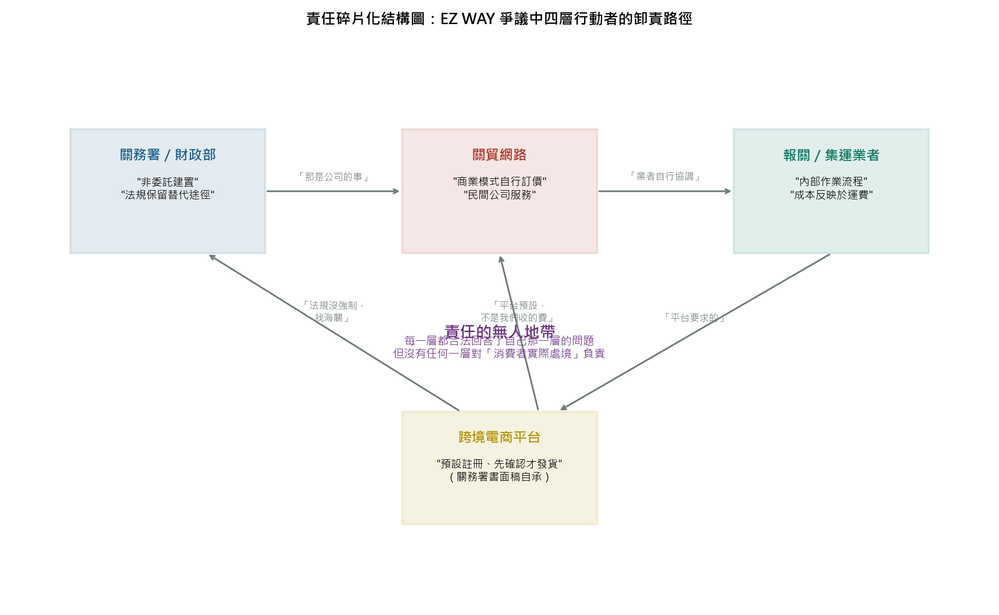

# 委外、專案分工與責任碎片化：從 EZ WAY 案看 KPI 卸責結構

**日期：2026-10-08｜性質：結構分析（接續《EZ WAY 關貿爭議完整研究報告》與《對抗消耗監督資源》之組織層次分析）**

---

## 一、問題的定式

你提出的定式是：企業委外、政府委外，以及「先以專案分工、再以組織分工切割專案」的操作，使 KPI 碎片化、失去 OKR 的單一目的與單一負責人，最終把人的責任碎片化以卸責。這個定式可以拆成三個可檢驗的結構命題：

1. **委外創造責任介面**：每多一個委外層，就多一個「那是他的事」的合法回應點。
2. **專案分工再切碎責任單元**：同一件事被切成多個專案後，每個專案有自己的指標，但沒有任何一個指標等於「事情本身做好了沒有」。
3. **KPI 全部達標，OKR 完全失敗**：碎片化的指標可以被逐個優化，而真正的結果（消費者有選擇、費用透明、有人負責）沒有歸屬。

以下用 EZ WAY 案已查證的事實逐一檢驗。

## 二、委外的責任光譜：EZ WAY 是一種極端形態

委外不是單一制度，而是一條光譜。光譜的一端是「契約明確的委外」：政府與廠商簽約，標的、驗收、罰則、履約責任白紙黑字——責任雖然移轉，但移轉的方向與範圍是清楚的，出了問題可以沿著契約往回找。光譜的另一端是 EZ WAY 案呈現的形態：**實質功能委外、法律形式無契約**。

關務署對 EZ WAY 的定性是「關貿因應法規鬆綁自行投資建置，並非海關委託，兩造間無契約」。這句話在 2026 年 8 月的脈絡中是防守——用來阻斷「政府為何不負責」的追問。但從組織理論看，它其實揭示了一種比委外更徹底的責任切割：**委外至少還有契約可以追責，無契約的功能移轉連追責的錨點都不存在**。線上委任這個「政府制度要求的必要功能」，由一家政府持股 36.11%、董事會過半的官股民營公司執行，卻在任何法律文件上都不被承認為「政府的作為」。形式無契約、實質有依賴——這是委外責任切割的極限形態，也是為什麼本案的責任追問會反覆在「政府／公司」之間被打回。

企業委外與政府委外在這個意義上共享同一力學：委外移轉的不只是工作，還有「回答問題的位置」。當功能在組織內部時，首長必須回答關於這個功能的全部問題；當功能委外後，組織只需要回答「廠商有沒有照約履行」——而「約」裡寫了什麼，決定了哪些問題從此不會被任何人回答。

## 三、「專案分工後再以組織分工專案」：一個事件的解剖

EZ WAY 制度的 8 年，可以精確解剖為一串被切割的專案。每一刀都是合理的，但每一刀都切掉了一部分責任的完整性：

| 專案切片 | 負責單元 | 該專案的 KPI | 切掉的責任部分 |
|---|---|---|---|
| 法規鬆綁（2018） | 關務署（法規） | 線上委任機制上路 | 「為什麼只有一家業者被邀評估」無人回答 |
| 系統建置（2018–） | 關貿（公司） | App 上線、註冊數成長 | 「收費是否合理」被定義為商業決策 |
| 收費協商（2020/6） | 關務署（監管）＋關貿 | 調降費率、定下收費上限 | 「長期費率規範」無專案承接，協商後即失焦 |
| 委任檢核（2020/5） | 關務署（通關） | 委任確認率、冒名報關防堵 | 「未完成委任的消費者處境」不在指標內 |
| 資安認證（持續） | 關貿（資安） | ISO 27001／27018、N-SOC 聯防 | 「為什麼是民間公司持有 759 萬人個資」被認證覆蓋 |
| 預先委任推動（2021–2026/3） | 關務署（政策） | 採用率逾 8 成 | 「消費者是否有真實選擇」與採用率指標方向相反——採用率越高，替代方案越不需要 |

這就是「以組織分工專案」的實際效果：**每個切片都有明確的負責人與可達成的指標，切片之間的縫隙——「消費者實際處境」——則不屬於任何一個專案**。關務署 8 月的三份書面稿之所以每份都只回答一半的問題，不是溝通不良，而是組織結構使然：寫稿的人只被授權回答自己那一格的事。

## 四、KPI 碎片化 vs. OKR 單一負責人

用管理語言精確表述你的直覺：**KPI 是對局部負責，OKR 是對結果負責。碎片化的責任結構可以無限供應前者，同時系統性消滅後者。**

KPI 碎片化的卸責機制有三個環節。第一，**指標替代**：當「真實選擇存在」無法被量化，而「採用率」可以被量化時，報表上就永遠是好消息——截至 2025/11/30 預先委任採用率逾 8 成，這個數字在每一期簡報中都是績效，儘管它同時度量的是市場單一化的加深。第二，**達標卸責**：每個專案的負責人都能誠實地說「我的指標達成了」——App 穩定運作（關貿達標）、冒名報關減少（關務署達標）、資安無事故（資安達標）——而消費者在平台流程中別無選擇這個事實，不屬於任何人的指標。第三，**無人可問**：OKR 要求單一目的對應單一負責人；當責任被切成六個專案分屬四個組織後，「誰對 EZ WAY 負總責」這個問題的誠實答案是「沒有人」——這不是推卸，是結構的描述。

「3 個月內提出檢討報告」這個承諾本身，就是 KPI 碎片化最好的標本。它是一個**沒有主人的 KPI**：報告由關務署提出，但檢討對象涉及財政部持股利益、關貿商業模式、平台流程——報告寫出來那天，沒有任何一個人的職位會因為報告寫得不好而負責。相反，報告延遲也不會有任何人的考績受影響。一個沒有 OKR 錨點的 KPI，本質上是卸責的定時器。

## 五、卸責是結構的輸出，不是個人的品德

這裡必須承接前兩份報告反覆強調的原則：**不需假定意圖**。卸責結構最危險的性質，是它讓每一個參與者都可以是誠實的、勤勉的、甚至是以公共利益為念的，而系統的輸出仍然是卸責。關務署官員真心相信自己在防冒名報關；關貿的工程師真心相信自己的 App 比紙本進步；寫 8 成採用率簡報的人真心相信那是政績。沒有人需要「決定」卸責——結構已經替所有人做好了決定。這與「對抗消耗監督資源」的機制是同一族：無意的合謀（convergence without conspiracy）。

也因此，這個分析對「企業委外／政府委外」的判斷不是「委外不好」，而是：**委外是責任的重排，重排的規則決定了誰從此不必再回答問題**。好的委外把責任錨點寫進契約（明確的單一履約負責人、結果導向的驗收、未達結果的歸責路徑）；壞的委外——包括無契約的功能移轉——把「回答問題的義務」溶解在介面裡。

## 六、結構圖與改善方向

改善方向因此不是「加強考核」，而是**重建單一負責人**：對 EZ WAY 這類「監管要求產生的準必要服務」，應由法律明定一名政治層級的單一負責人（例如關務署長對外負全責、且不以「無契約」為卸責理由），並把 OKR 寫成可驗證的結果指標——「消費者在原交易流程中有無成本相當的替代途徑」「收費結構是否公開」——而非過程指標。在企業面，同樣的原則是：每個委外介面都要問一句「這個介面讓誰從此不必回答哪個問題」，並把答案寫進契約的問責條款。KPI 可以碎片化，問責不行——這是 OKR 相對於 KPI 的本質優勢，也是本案給所有組織——無論公私——最昂貴的一課。

**體系位置**：本分析的三層框架（委外介面 × 專案切片 × KPI/OKR 錯位）已在《碎片化框架第二案例：台電虧損》完成跨案例驗證，並由《碎片化檢驗框架：多案例擴充報告（v2，2026-10-09）》擴充為十案例綜合矩陣；框架的治理工具史縱深（ISO→6σ→BSC→OKR→委外化）見《MBB 卸責槽與治理必然性》；企業層的個案鑑識方法（claimed culture vs. real culture、三鏈驗證）見 MBB 語料彙整。

---

**免責聲明**：本分析為組織結構層次的學理性討論，對所引機關與公司人員不作任何個人品德或法律責任之評價；文中「卸責」均指結構效果，非指涉個人故意。
