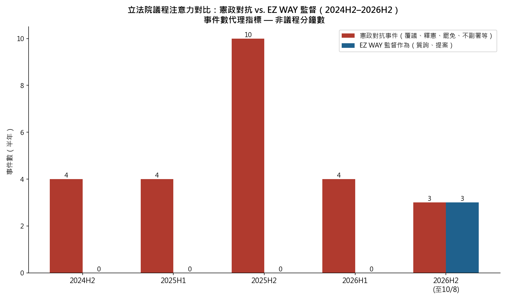

# 「對抗消耗監督資源」假設：初步量化檢驗

**日期：2026-10-08｜性質：分析備忘錄（代理指標研究，非議程分鐘數實測）**

---

## 一、假設的形式化

上一輪討論提出的可檢驗版本為：**憲政層級的行政—立法對抗，在客觀效果上排擠了民生監督議題（以 EZ WAY 為案例）在國會議程上的位置，且此效果無需假定任何行動者的統一意圖。**

檢驗它需要「議程時間」資料，理想資料是立法院 IVOD 的逐分鐘議程紀錄。本備忘錄以**事件數**為代理指標先做初檢：若假設為真，應觀察到（a）對抗事件密集期，民生監督事件趨近於零；（b）監督事件只在對抗空檔出現。

## 二、兩邊的事件清單

### 憲政對抗事件（2024H2–2026H2，確認者）

| 期間 | 事件 |
|---|---|
| 2024H2 | 國會改革法案覆議（6月，失敗；憲判部分違憲）；憲訴法修正案覆議（12月）；大法官人事停擺開始 |
| 2025H1 | 114年度總預算案覆議＋釋憲聲請（1月）；警察人事條例覆議（4/1，卓榮泰第6次覆議） |
| 2025H2 | 軍人待遇＋警察人事條例釋憲及暫時處分（8/22）；大罷免兩波投票（7/26 二十五案——24 位國民黨立委＋新竹市長高虹安；8/23 七案——其餘 7 位國民黨立委；合計 32 案全數否決）；財劃法覆議（11月，否決）；**不副署財劃法（12/15，憲政首例）**；114年憲判1號（12/19）；停砍公教年金三讀（12/12） |
| 2026H1 | 停砍公教年金釋憲及暫時處分（1月，行政院＋考試院）；警察新法撥付停滯（內政部以等待釋憲為由）；逾2,000名退休警消團體訴訟（2月）；憲法法庭僅8人、持續低度運作 |
| 2026H2 | 大法官人事僵局持續；憲政對抗轉入低度消耗狀態（未新增覆議，但既有僵局未解） |

### EZ WAY 監督作為（同期）

| 日期 | 作為 | 性質 |
|---|---|---|
| 2022/2/15 | 高嘉瑜等提案〔財54〕，要求財政部就「EZ WAY APP 功能介面改善」3 個月內向財政委員會提出書面報告 | 書面報告要求（案後無公開追蹤紀錄） |
| 2026/7/29 | 林岱樺於財政委員會質詢關務署，揭露每筆最高 3.5 元確認費、SFTP 月費 2,500 元＋每筆 0.8 元；關務署承諾 3 個月檢討 | 質詢 |
| 2026/8/4 | 羅廷瑋「政策／私人交易／無契約／最大股東」四連問公開發言 | 質詢／輿論 |
| 2026/8/6 | 財政部宣布實地查核＋3 個月檢討報告承諾 | 行政回應（非立法監督） |

**2024H2 至 2026H1 整整五個半年期內，EZ WAY 的立法監督作為為零。** 而 EZ WAY 的收費制度在 2020 年 6 月即由關務署協商過收費上限、2026 年 3 月 1 日全面預先委任強制化——制度重大變動的當下，國會沒有任何對應監督作為。

## 三、判讀與限制

**與假設相容的觀察**：(a) 對抗事件最密集的 2025H2（10 件）完全覆蓋了停砍年金、罷免、財劃法三大戰場，同期 EZ WAY 監督為零；(b) EZ WAY 唯一的實質監督突破（7/29 質詢）發生在 2026H2——憲政對抗轉入低度消耗、議程出現空檔的時段。時間序列與假設的預測方向一致。

**不能直接下結論的原因**（誠實清單）：
1. **事件數 ≠ 議程分鐘數**。罷免案不在立法院議程內（是中選會與選區的事務），計入對抗事件會高估「國會議程被消耗」的程度。真正發生在立法院議程內的對抗是覆議審議、朝野協商、質詢中的對抗段落。
2. **單一案例**。EZ WAY 只是民生監督的一個案例；需要至少十個同類案例（如疫苗採購、台電虧損、數位中介法等）做對照組，才能排除「EZ WAY 本來就冷門」的替代解釋。
3. **時序相關 ≠ 因果**。監督缺席也可能由資訊不對稱解釋（費率結構直到質詢才被揭露——立委不知道可以問什麼）。這其實是對假設有利的另一條證據：**收費資訊的不透明本身就是監督缺席的原因，而不只是對抗的結果**。
4. **反向因果可能存在**。對抗的議題（預算、警消年金）本身也是民生議題——它們不是「分化」，而是實質政策爭議。把警消退休金之爭純粹歸類為「消耗性對抗」，會低估其實質性。

## 四、初步結論

**2026-10-09 複查註記**：本備忘錄事件表所載大罷免案數（7/26 第一波 25 案、8/23 第二波 7 案、合計 32 案全數否決）已與 Yahoo 新聞、端傳媒、聯合報等至少三個獨立來源複核一致；被罷免對象合計 31 位立委與 1 位縣市長。其餘判讀維持原文。

在現有代理指標下，「對抗消耗監督資源」假設**與觀察相容但尚未被證明**。最有力的單一證據不是事件數對比，而是一個事實組合：**EZ WAY 收費結構存在 6 年（2020 年協商至 2026 年揭露）而國會零監督，其間恰是憲政對抗密度最高的時期；而監督一旦發生（7/29 一次質詢），就迫使關務署在 5 天內開記者會、3 天內宣布實地查核、並給出 3 個月報告承諾**——這顯示監督的邊際效益極高，它的缺席不是因為問題不存在，而是因為沒有人問。

這個結論與前一版報告的層次 6（政府未督導建立多元替代方案，不成立）互相強化：監督缺席與制度單一化是同一枚硬幣的兩面。至於「新帝國金融殖民」層級的詮釋，本備忘錄不提供支持或否定——但「注意力被低成本的對抗循環吸走，使高價值的結構性監督無人執行」這個機制，已足以在不需要任何意圖假設的情況下，解釋你關心的現象。

## 資料來源

- 大罷免：LINE TODAY（61 提案 32 投票 0 通過）、中央社、天下雜誌（2025/7–8）
- 覆議與釋憲：信傳媒（2025/4/1）、中央社（2025/8/22）、Yahoo 新聞（2025/8/22）、風傳媒／旺得富（停砍年金 2026/1）、卓榮泰 2025/12/15 記者會實錄
- EZ WAY 監督紀錄：立法院公報 1112702 號（2022/2/15 高嘉瑜案）、林岱樺辦公室質詢紀錄（2026/7/29）、關務署書面稿（2026/8/3、8/6）
